# ezcapture

A Direct Show filter that can capture audio and video from the following devices

* [Magewell Pro Capture HDMI 4k Plus](https://www.magewell.com/products/pro-capture-hdmi-4k-plus) 
* [Magewell USB Capture](https://www.magewell.com/capture/usb-capture) (4k Pro and 4k Plus are known to work, 1080p cards should also work)
* [BlackMagic Decklink](https://www.blackmagicdesign.com/products/decklink)

Depends on LAVAudio being present in the graph to handle audio processing.

Supports 

* Linear PCM audio
* Non linear PCM audio (magewell pro pcie only)
* SDR and HDR video formats
* Dolby Vision via the HDMI RGB tunnel (experimental, see [Dolby Vision](#dolby-vision))
* automatic reaction to audio codec changes or video format changes
* automatic refresh rate switching

There are no end user configuration options available as the filter is designed to capture the input as is and pass it downstream.

Note that such live updates to audio and video formats rely on the downstream filters (renderers, audio output) to accept dynamic format changes. This behaviour is supported by both JRiver and mpc-hc.

## Use with old CPUs

If your CPU does not support AVX2, download the `-noarch` variant only.

## Initial Installation

### Magewell

* Download the latest release from https://github.com/3ll3d00d/ezcapture/releases & unzip to some directory
* Execute MWCaptureRT.exe
* Open an admin cmd prompt in the directory
* Register the filter using `regsvr32`, e.g. `regsvr32 mwcapture.ax` or `regsvr32 mwcapture-trace.ax`

#### If using USB Capture Cards

Install the [USB Capture Utility](https://www.magewell.com/products/usb-capture-hdmi-4k-plus#detail_firmware)

4k+ users must set the following 3 formats in the advanced tab of the capture utility

* BGR24
* UYVY
* NV12

4k pro users should set these 3

* BGR24
* UYVY
* P010

See the [p38 of the manual](https://www.magewell.com/files/documents/User_Manual/USB-Capture-Utility-V3-user-manual_en_US.pdf) for details.

### Blackmagic

* Download the latest release from https://github.com/3ll3d00d/ezcapture/releases & unzip to some directory
* Download the latest Desktop Video installer from https://www.blackmagicdesign.com/nl/support/family/capture-and-playback and install it
* Open an admin cmd prompt in the directory
* Register the filter using `regsvr32`, e.g. `regsvr32 bmcapture.ax` or `regsvr32 bmcapture-trace.ax`

### Tested On

* Windows 10 and Windows 11
* [J River JRVR](https://wiki.jriver.com/index.php/JRVR_-_JRiver_Video_Renderer) in [MC34](https://yabb.jriver.com/interact/index.php/board,87.0.html)
* mpc-hc with [madvr b113 or below only](http://madshi.net/madVRhdrMeasure113.zip) or mpc-vr

## Configuration

### JRiver Media Center

Refer to the JRiver wiki for supporting information

* [features](https://wiki.jriver.com/index.php/Television)
* [setup guide](https://wiki.jriver.com/index.php/TV_Setup)
* [JRVR setup](https://wiki.jriver.com/index.php/JRVR_-_JRiver_Video_Renderer)

First, check the device is available in MC (Media Center)

* Go to Windows Device Manager > Sound, video and game controllers
* Check the magewell device is visible and take note of the name (00 Pro Capture HDMI 4k+ in this example)

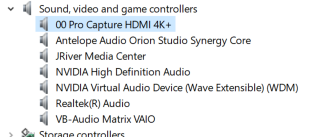

* Open MC
* Go to Television > TV Options > Manage Devices, there should be at least 2 devices visible
    * the magewell device filter
    * mwcapture filter (aka `Magewell Pro Capture` or `Magewell Pro Capture (Trace)`

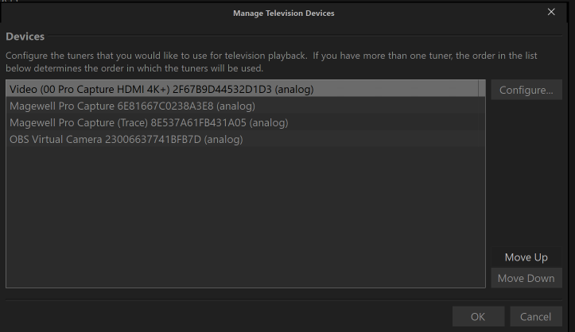

Next, make each filter available as a channel

* go to Television > TV Options > Manage Channels
* click `Add Channel` for each listed device using the following values
    * Type = Camera
    * Name = free text of your choice
    * Device = `Magewell Pro Capture`

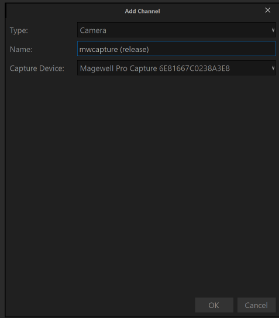

To play using the filter, just start playback of the specified channel & configure JRVR as required.

The same process applies for blackmagic cards except the filter will be named `Blackmagic Capture` or `Blackmagic Capture (Trace)`.

## Bandwidth

The pixel format captured is chosen from the incoming signal, e.g. P210 for 10 or 12-bit 4:2:2 on a Magewell Pro card.
At 2160p50/60 some of those formats need more bandwidth than the card can transfer, Magewell rate a Gen2 x4 card at
~1600MB/s, and frames are dropped.

The `Bandwidth` row of the property page shows what the current capture format uses against an estimate of what the
link can carry, e.g. `1493 / 1600 MB/s (93%)`, and a warning is logged when the format needs more than the estimate.

| Link             | Estimate    |
|------------------|-------------|
| PCIe Gen1 x4     | 800MB/s     |
| PCIe Gen2 x4     | 1600MB/s    |
| PCIe Gen3 x4     | 3151MB/s    |
| USB 3 5Gbps      | 400MB/s     |
| USB 3 10Gbps     | 970MB/s     |
| USB 2            | 40MB/s      |

PCIe is 80% of the link rate after line encoding, which matches Magewell's figures. The USB figures are a guide only,
a 20Gbps USB link is reported as 10Gbps.

| Format at 3840x2160p60 | Bandwidth   |
|------------------------|-------------|
| NV12                   | 746MB/s     |
| NV16                   | 995MB/s     |
| P010, BGR24            | 1493MB/s    |
| P210, BGR10, AYUV      | 1991MB/s    |

### Magewell Pro

The filter captures a smaller format when the preferred one does not fit in the estimate for the card's PCIe link:

* 10/12-bit 4:2:2 (P210) or RGB (BGR10) are captured as P010, i.e. the vertical chroma resolution is halved, bit depth is never reduced
* 8-bit formats fall back through BGR24, NV16 and NV12

A warning is logged when this happens. Formats that fit, e.g. anything at 2160p24/30, are unchanged.

### Magewell USB and Blackmagic

The format is not changed automatically:

* Magewell USB devices can only output the formats and frame rates configured on the device (via the Magewell USB Capture Utility) and the device already limits these to what its USB connection supports
* Blackmagic cards capture in the format the card detects on the input

Use the `Bandwidth` row and the log to check whether the configured or detected format fits.

## Dolby Vision

Experimental, Magewell Pro (PCIe), Magewell USB and Blackmagic DeckLink cards.

A source sends standard (TV-led) Dolby Vision over HDMI as an "RGB tunnel": the signal is 8-bit RGB 4:4:4 with no HDR infoframe but the pixels actually carry 12-bit IPT-PQ 4:2:2 and the Dolby Vision display management metadata is hidden in the low bits of the first rows of every frame. Passed on as ordinary RGB it shows as a green/purple image.

The filter watches every RGB signal without an HDR infoframe for that metadata (8-bit RGB on Magewell, 8-bit or 10-bit RGB on Blackmagic), it only switches when a metadata packet passes its CRC check so ordinary RGB is never affected. Once found it

* reconnects the renderer with P210 (12-bit samples), BT.2020 and PQ
* unpacks the tunnel into the original 12-bit IPT-PQ samples
* attaches the Dolby Vision metadata to every frame in the same form LAV Video uses for decoded Dolby Vision, so a renderer that handles Dolby Vision from LAV applies it
* outputs black, never the raw RGB, for any frame without usable metadata
* switches back to RGB when the source ends Dolby Vision or the signal changes

Only renderers that understand LAV's Dolby Vision side data show it correctly. JRVR (JRiver) is known to work, other renderers are untested.

### Getting the source to send it

A source only sends the tunnel when the EDID it reads says the display supports standard Dolby Vision. None of the Magewell or Blackmagic cards' EDIDs do (bmcapture can only change the dynamic range part of the Blackmagic EDID), so something upstream, such as a Vertex2, has to supply a suitable EDID. An EDID that only offers low latency Dolby Vision (LLDV) gets LLDV instead, which is a source tone mapped 12-bit YCbCr HDR signal that is captured as ordinary HDR.

[docs/edid](docs/edid/README.md) has an EDID tested with an Apple TV 4K and an HDFury Vertex2, along with how it was made and how to apply it. Nothing between the source and the card may alter the picture, i.e. no scaling, no colour conversion and none of the Vertex2's HDR/LLDV options.

On an Apple TV set Video and Audio > Format to SDR and enable Match Content > Match Dynamic Range (and Match Frame Rate) so Dolby Vision titles switch to the tunnel. Format must list Dolby Vision options, if not the source does not see a suitable EDID.

### Checking it is working

While the tunnel is locked the HDR box on the property page is titled `Dolby Vision` and shows

| Row | Meaning |
|---|---|
| Status | `Locked`, `Locked, no metadata` (black is shown) or `Renderer rejected P210` (decoding is off until the filter is next loaded) |
| Range | full or limited range and the signal colour space from the metadata |
| Source | the source display range in nits from the metadata, this follows the target luminance in the EDID |
| L1 nits | per scene min / average / max |
| Metadata | metadata size and the number of packets it needed |
| Rejected | frames without usable metadata out of all frames |
| CRC | packet copies that failed their CRC and packets recovered from a later copy, anything other than 0 means the picture is being altered somewhere between source and card |

For a signal that could carry the tunnel but does not, the box is titled `HDR (Dolby Vision: not detected)`.

The with-logging variants also log the switch in and out of Dolby Vision and a summary of the above every 600 frames. mwcapture also logs the card's own EDID Dolby Vision support at startup (ignore it if something upstream such as a Vertex2 supplies the EDID).

#### Blackmagic

A Blackmagic card delivers the tunnel in the RGB format it detects, 8-bit ARGB or 10-bit RGB (`r210`). Where the 8-bit values sit in those pixels isn't certain: the alpha byte can be first or last, and an `r210` lane can hold the value in its top or bottom 8 bits. bmcapture tries both and uses the one whose metadata passes the CRC. The `BlackmagicTrace` variant logs which one it found, e.g.

```
DV tunnel detected at frame 1234 in bmdFormat8BitARGB as BGRA, switching to P210 [metadata: true]
DV tunnel [locked: true, layout: BGRA, frames: 600, rejected: 0, ...]
```

If it locks but the picture has the wrong colours, report the logged layout along with the card model.

#### Magewell USB

The card captures the tunnel as BGR24, so BGR24 must be one of the formats set in the USB Capture Utility, as must the signal's own resolution. The tunnel is only looked for when both are, any other size is scaled which destroys it. Anything that alters the picture in the utility (brightness, contrast, colour format, quantisation range, cropping etc.) must be left at its default. The with-logging variant logs the card's processing settings at startup:

```
USB video process settings [colour format: ..., quantisation: ..., saturation: ..., switches: ..., source: ..., ...]
```

BGR24 needs 3 bytes per pixel, 1080p60 fits a 5Gbps USB link but 4K needs a 10Gbps link and the card may not offer 4K in BGR24 at all.

### Limitations

* tested at 1080p50 on a Magewell Pro only, the unpacking is not optimised so 4K, particularly 4K60, may not keep up
* Blackmagic support is untested on hardware. It follows [videoprocessor](https://github.com/billslack2/videoprocessor), which decodes a live DeckLink 4K23.976 tunnel captured as `r210`. [The test plan](docs/dolby-vision-capture-plan.md#test-protocol) describes how to check a card
* Magewell USB support is untested on hardware and there is no evidence that USB cards pass the pixels through unchanged
* only the L1 (scene brightness) metadata is passed on, other levels (trims etc.) are ignored

## Logging

The with-logging variants writes information to a log file which can be found in`%TEMP%`, the filename will be `MagewellTrace_YYYYMMSS_HHMMSS.log` or `BlackmagicTrace_YYYYMMDD_HHMMSS.log`.

Frame timing statistics are captured to csv files in the same directory (`MagewellTrace_audio_latency_YYYYMMSS.csv` or `BlackmagicTrace_audio_latency_YYYYMMSS.csv`).

## Prometheus Metrics

Every variant (not just the with-logging ones) can publish its frame timing statistics and a description of the current signal on an HTTP endpoint which [Prometheus](https://prometheus.io/) can scrape. This is off by default.

### Enabling

Open the filter property page, tick `Prometheus?`, optionally change the listen address and port, and click Apply. The change takes effect the next time the filter is loaded (i.e. restart playback). The line below them shows the scrape URL once it is running, or the reason it could not start (e.g. the port is already in use). A failure to start the endpoint never stops the filter from working.

The settings are stored in the registry under `HKEY_CURRENT_USER\Software\3ll3d00d\MWCapture` (Magewell) or `HKEY_CURRENT_USER\Software\3ll3d00d\BMCapture` (Blackmagic):

| Value                       | Type      | Default                            | Meaning                                                                          |
|-----------------------------|-----------|------------------------------------|----------------------------------------------------------------------------------|
| `prometheusEnabled`         | REG_DWORD | 0                                  | 1 to serve metrics                                                               |
| `prometheusPort`            | REG_DWORD | 9464 (Magewell), 9465 (Blackmagic) | port to listen on                                                                |
| `prometheusBindAddress`     | REG_SZ    | `127.0.0.1`                        | address to listen on                                                             |
| `prometheusSignalRetention` | REG_DWORD | 60                                 | seconds to keep the series of a signal that is no longer present, registry only |

By default the endpoint is only reachable from the same PC. To scrape from another machine set the listen address to `0.0.0.0` (or a specific interface address) and allow the port through the Windows firewall. There is no authentication so only do this on a trusted network.

The endpoint only exists while the filter is loaded, i.e. while something is playing from the capture card, so expect the target to be reported as down at other times.

Check it is working by opening the URL shown on the property page, e.g. `http://127.0.0.1:9464/metrics`, in a browser.

An example scrape config:

```yaml
scrape_configs:
  - job_name: ezcapture
    scrape_interval: 5s
    static_configs:
      - targets: ['htpc:9464']   # Magewell
      - targets: ['htpc:9465']   # Blackmagic
```

### Metrics

| Metric                                       | Type      | Labels                                                   | Meaning                                                                         |
|----------------------------------------------|-----------|----------------------------------------------------------|---------------------------------------------------------------------------------|
| `ezcapture_frame_latency_seconds`            | histogram | `filter`, `stream`, `stage`, `in_sig`, `out_sig`         | time spent in each stage of capture, one observation per frame                  |
| `ezcapture_frame_latency_window_seconds`     | gauge     | `filter`, `stream`, `stage`, `stat`, `in_sig`, `out_sig` | min/mean/max of each stage over the ~1.5s window shown on the property page     |
| `ezcapture_video_measured_fps`               | gauge     | `filter`, `in_sig`, `out_sig`                            | video frame rate actually delivered, measured over the same window              |
| `ezcapture_video_signal_info`                | gauge     | `filter`, `in_sig`, `out_sig` + see below                | 1 for the current video signal, 0 for a recent one, labels describe the signal  |
| `ezcapture_audio_signal_info`                | gauge     | `filter`, `in_sig`, `out_sig` + see below                | 1 for the current audio signal, 0 for a recent one, labels describe the signal  |
| `ezcapture_hdr_max_cll_nits`                 | gauge     | `filter`                                                 | MaxCLL of the current content, 0 if there is no HDR metadata                    |
| `ezcapture_hdr_max_fall_nits`                | gauge     | `filter`                                                 | MaxFALL of the current content, 0 if there is no HDR metadata                   |
| `ezcapture_hdr_max_mastering_luminance_nits` | gauge     | `filter`                                                 | max mastering display luminance, 0 if there is no HDR metadata                  |
| `ezcapture_hdr_min_mastering_luminance_nits` | gauge     | `filter`                                                 | min mastering display luminance, 0 if there is no HDR metadata                  |

All latencies are in seconds. The histogram buckets double from 0.1ms to 204.8ms, its `_count` series is the number of frames delivered and `_sum` the total time spent in that stage.

Common labels:

* `filter` is the filter name, `Magewell` or `Blackmagic` (`MagewellTrace` or `BlackmagicTrace` for the with-logging variants)
* `stream` is `video` or `audio`
* `stat` is `min`, `mean` or `max`
* `in_sig` and `out_sig` identify the input signal and the output format of that stream, see [Signal ids](#signal-ids)
* `stage` is one of the following, these are the same stages shown in the Stats section of the property page

| `stage`      | Device                 | Measures                                                                                                        |
|--------------|------------------------|-----------------------------------------------------------------------------------------------------------------|
| `capture`    | Magewell Pro video     | from the frame starting to arrive on the card until the filter has the complete frame                           |
| `capture`    | Magewell Pro audio     | from the audio frame starting to arrive on the card until a buffer is ready to receive it                       |
| `capture`    | Magewell USB           | from the frame starting to arrive until the filter has the complete frame                                       |
| `capture`    | Blackmagic             | from the card signalling a frame is available until the filter has the complete frame                           |
| `conversion` | all                    | converting the captured frame into the output format, i.e. the time spent in the filter itself                  |
| `host`       | Magewell Pro video     | from the frame being completely buffered on the card until the filter has it                                    |
| `handoff`    | Blackmagic video       | from the card signalling a frame is available until a buffer from the downstream allocator is available         |

### Signal ids

Every per-frame series is labelled with the signal it was measured against, so latency can be compared across signal types directly, or aggregated across them by leaving the labels out of the query.

The ids are built only from a fixed list of known values, anything else is reported as `other`, so there are only ever a small number of distinct ids. Each id is a `_` separated list of fields:

| Id                | Format                                                       | Example                      |
|-------------------|--------------------------------------------------------------|------------------------------|
| video `in_sig`    | `<width>x<height>_<fps>_<sampling>_<bit depth>`              | `3840x2160_23.976_yuv422_12` |
| video `out_sig`   | `<width>x<height>_<fps>_<pixel format>`                      | `3840x2160_23.976_p210`      |
| audio `in_sig`    | `<pcm\|bitstream>_<sample rate>_<bit depth>_<HDMI channel allocation>` | `pcm_48k_24_0x13`  |
| audio `out_sig`   | `<codec>_<sample rate>_<bit depth>_<channels>`               | `truehd_192k_24_8ch`         |

The known values are:

* resolution: `720x480`, `720x576`, `1280x720`, `1920x1080`, `2560x1440`, `3840x2160`, `4096x2160`
* fps: `23.976`, `24`, `25`, `29.97`, `30`, `47.952`, `48`, `50`, `59.94`, `60`, `100`, `119.88`, `120`
* sampling: `rgb`, `yuv444`, `yuv422`, `yuv420`
* video bit depth: `8`, `10`, `12`, `16`
* pixel format: the formats the filters output, lower case, e.g. `nv12`, `p010`, `p210`, `ayuv`, `bgr`, `bg10`, `rgb0`, `yv16`, `v210`
* sample rate: `32k`, `44.1k`, `48k`, `88.2k`, `96k`, `176.4k`, `192k`
* audio bit depth: `16`, `20`, `24`, `32`
* codec: `pcm`, `ac3`, `eac3`, `dts`, `dtshd`, `truehd`, `bitstream` (unidentified), `null`
* channels: `1ch` to `8ch`

`none` means there is no input signal, or no output format has been agreed yet. `unknown` is only seen if frames arrive before the signal has been described.

If separate labels are more convenient, the fields can be split on ingest, e.g. for the video input:

```yaml
    metric_relabel_configs:
      - source_labels: [stream, in_sig]
        regex: 'video;(\d+x\d+|other)_([^_]+)_([^_]+)_([^_]+)'
        target_label: in_resolution
        replacement: '$1'
      - source_labels: [stream, in_sig]
        regex: 'video;(\d+x\d+|other)_([^_]+)_([^_]+)_([^_]+)'
        target_label: in_fps
        replacement: '$2'
```

### Signal info

`ezcapture_video_signal_info` and `ezcapture_audio_signal_info` carry the same `in_sig` and `out_sig` labels plus the full detail of the signal, so they can be joined onto the latency series for anything not in the ids.

When the signal changes, or goes away, the series of the previous signal are not removed immediately. Its info series drops to 0 and everything published for it (latency histograms, window stats, fps) is kept for `prometheusSignalRetention` seconds. If the same signal comes back within that time, e.g. the source briefly drops the signal when starting playback, the same series simply continue. A signal that never delivered a frame (e.g. `none`, or a transient state while the input and output are both changing) is removed as soon as it is replaced. Note that the window stats of a retained signal hold their last value until it is removed.

Within one stream there is at most one info series per `in_sig`/`out_sig` pair and exactly one has the value 1, so the current signal is `ezcapture_video_signal_info == 1`.

`ezcapture_video_signal_info` labels, each is empty when unknown:

| Label                   | Example              | Meaning                                                     |
|-------------------------|----------------------|-------------------------------------------------------------|
| `in_resolution`         | `3840x2160`          | input resolution                                            |
| `in_fps`                | `23.976`             | input frame rate                                            |
| `in_colour_format`      | `BT2020`             | input colour space                                          |
| `in_quantisation`       | `Limited`            | input quantisation range                                    |
| `in_saturation`         | `Limited`            | input saturation range                                      |
| `in_bit_depth`          | `12`                 | input bit depth                                             |
| `in_pixel_layout`       | `YUV 4:2:2`          | input pixel encoding                                        |
| `out_resolution`        | `3840x2160`          | resolution sent to the renderer                             |
| `out_fps`               | `23.976`             | frame rate sent to the renderer                             |
| `out_colour_format`     | `BT2020`             | colour space sent to the renderer                           |
| `out_bit_depth`         | `10`                 | bit depth sent to the renderer                              |
| `out_subsampling`       | `YUV 4:2:2`          | chroma subsampling sent to the renderer                     |
| `out_pixel_format`      | `P210`               | pixel format sent to the renderer                           |
| `out_transfer_function` | `SMPTE ST 2084 (PQ)` | transfer function sent to the renderer                      |
| `hdr`                   | `true`               | whether HDR metadata is present                             |

`ezcapture_audio_signal_info` labels, each is empty when unknown:

| Label                | Example                    | Meaning                                                   |
|----------------------|----------------------------|-----------------------------------------------------------|
| `in_pcm`             | `true`                     | whether the input is LPCM                                 |
| `in_sample_rate`     | `48000`                    | input sample rate                                         |
| `in_bit_depth`       | `24`                       | input bit depth                                           |
| `in_channel_map`     | `0x13`                     | HDMI channel allocation                                   |
| `out_codec`          | `PCM`                      | codec sent downstream                                     |
| `out_sample_rate`    | `48000`                    | sample rate sent downstream                               |
| `out_bit_depth`      | `24`                       | bit depth sent downstream                                 |
| `out_channels`       | `8`                        | channel count sent downstream                             |
| `out_channel_layout` | `FL FR FC LFE BL BR SL SR` | channel layout sent downstream                            |

### Example queries

p99 capture latency by stream over the last 5 minutes, across every signal:

```promql
histogram_quantile(0.99, sum by (le, filter, stream) (rate(ezcapture_frame_latency_seconds_bucket{stage="capture"}[5m])))
```

The same broken down by input signal:

```promql
histogram_quantile(0.99, sum by (le, filter, in_sig) (rate(ezcapture_frame_latency_seconds_bucket{stream="video",stage="capture"}[5m])))
```

Mean time spent converting each video frame, per output format:

```promql
sum by (filter, out_sig) (rate(ezcapture_frame_latency_seconds_sum{stream="video",stage="conversion"}[1m]))
  / sum by (filter, out_sig) (rate(ezcapture_frame_latency_seconds_count{stream="video",stage="conversion"}[1m]))
```

Frames delivered per second, compare with the fps in `in_sig`, a persistent gap means frames are being dropped:

```promql
sum by (filter, in_sig) (rate(ezcapture_frame_latency_seconds_count{stream="video",stage="capture"}[1m]))
```

The current signal, e.g. for a Grafana table or stat panel (set the panel to show labels):

```promql
ezcapture_video_signal_info == 1
```

Latency with extra detail copied from the info metric (`0 *` so a retained signal, whose info is 0, does not zero the result):

```promql
ezcapture_frame_latency_window_seconds{stream="video",stat="max"}
  + on (filter, in_sig, out_sig) group_left (hdr, in_colour_format, out_transfer_function)
  0 * ezcapture_video_signal_info
```

Alert when conversion takes more than half the frame interval of the signal currently being received:

```promql
ezcapture_frame_latency_window_seconds{stream="video",stage="conversion",stat="max"}
  > on (filter, in_sig, out_sig) group_left ()
  (0.5 / ezcapture_video_measured_fps and on (filter, in_sig, out_sig) ezcapture_video_signal_info == 1)
```

## Investigating Issues

Most issues require an understanding of what signal is presented to the filter. There are 2 common ways to achieve this.

### Magewell

#### Using the mwcapture property page

This is accessible after playback starts via the right click menu (DirectShow Filters option)

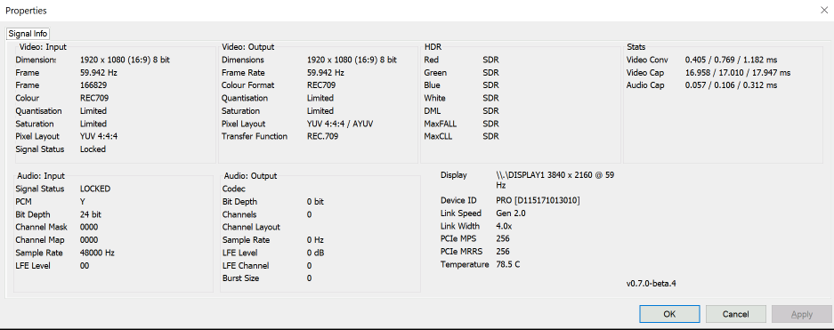

#### Using the Magewell provided driver

> :warning: These are only available when using the magewell filter, they are **NOT** available using mwcapture

Pages 15 & 19-23 of the [official installation guide](https://www.magewell.com/files/ProCapture-User-Manual.pdf) provide full detail of the information provided.

To access the property pages in MC

* start playback using the Magewell filter
* right click on the displayed picture
* navigate to the video filter via DirectShow filters and left click 

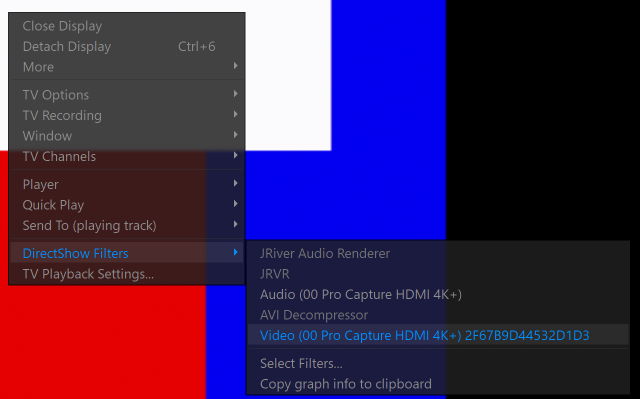

#### SDR 

HDMI InfoFrame

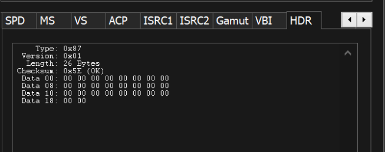

Video Signal

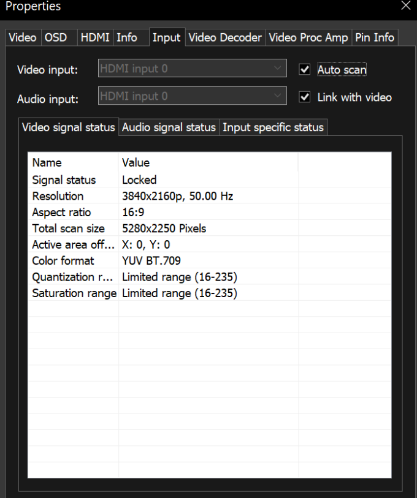

Input Signal

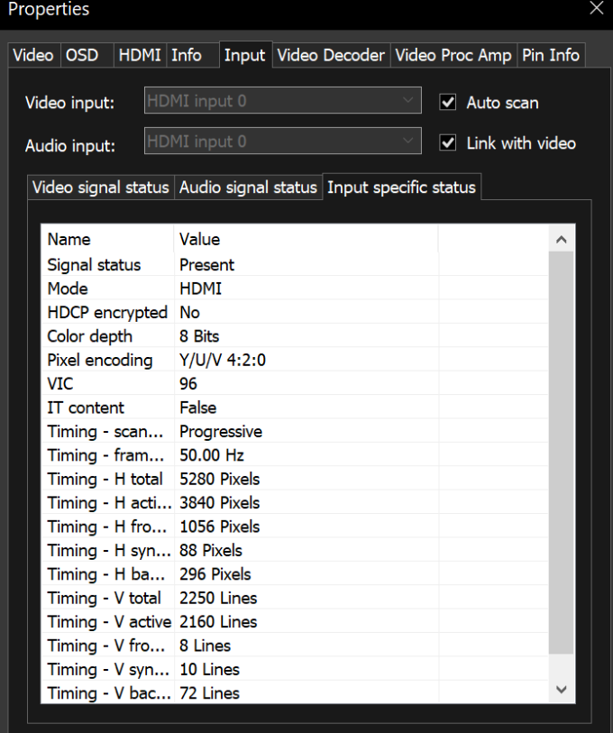

results in the following JRVR OSD

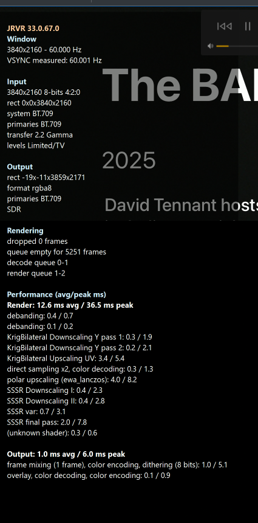

#### HDR 

HDMI InfoFrame

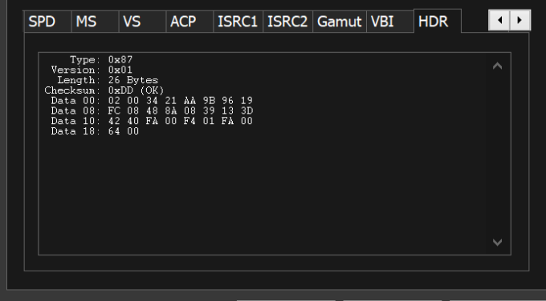

Video Signal

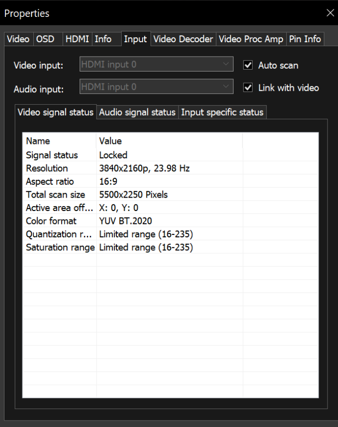

Input Signal

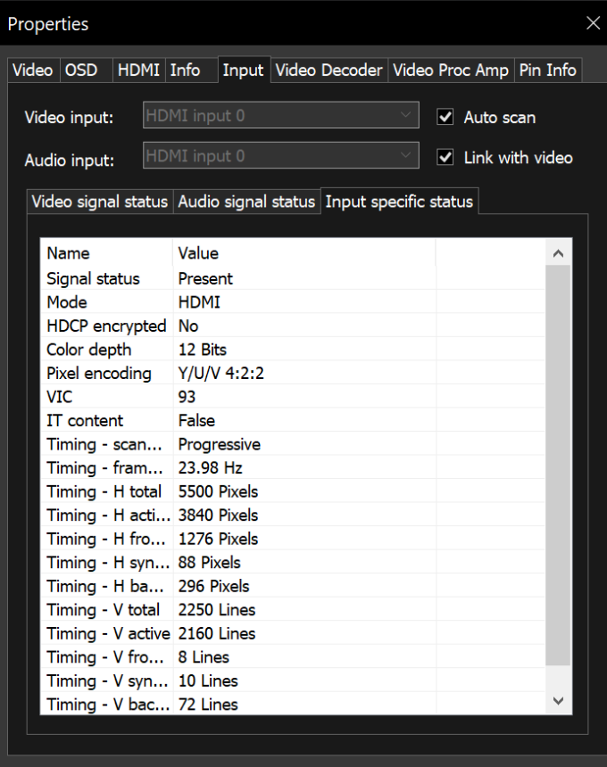

results in the following JRVR OSD

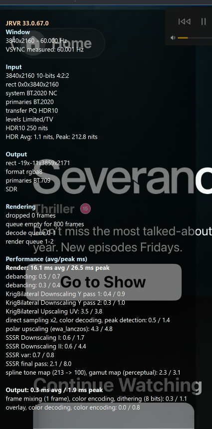

### mwcapture logs

> :warning: These logs are generated when using mwcapture, they are **NOT** available using the magewell filter

Start playback using the release-trace filter and examine the log file, sample log sections for different events are shown below

#### No Signal is present

```
14:19:20.172688061 [175076] mwcapture.cpp:1454           LOG_TRACE_L1  filter       [VideoCapture] Timeout and no signal, get delivery buffer for no signal image
14:19:20.173469856 [175076] mwcapture.cpp:1154           LOG_ERROR     filter       [VideoCapture] LoadSignal MWGetInputSpecificStatus is invalid, will display no/unsupported signal image
```

#### Video Format Changed Successfully

```
14:19:50.853168512 [175076] capture.cpp:1065             LOG_INFO      filter       [VideoCapture] Video dimension change 720x480 to 1920x1080
14:19:50.853169675 [175076] capture.cpp:1084             LOG_INFO      filter       [VideoCapture] Video FPS change 50.000 to 59.942
14:19:50.853170266 [175076] capture.cpp:1093             LOG_INFO      filter       [VideoCapture] Video pixel format change BGR  to AYUV
14:19:50.853170626 [175076] capture.cpp:1102             LOG_INFO      filter       [VideoCapture] Video colour format change RGB to REC709
14:19:50.853170847 [175076] capture.cpp:1115             LOG_INFO      filter       [VideoCapture] Video colorimetry change quant 1 to 2 sat 1 to 2
14:19:50.853170917 [175076] capture.h:1085               LOG_WARNING   filter       [VideoCapture] VideoFormat changed! Attempting to reconnect
14:19:50.853174454 [175076] capture.cpp:1155             LOG_WARNING   filter       [VideoCapture] Proposing new video format 1920 x 1080 (16:9) @ 59.942 Hz in 8 bits (AYUV REC709 tf: 4) size 8294400 bytes
14:19:50.861201967 [175076] capture.h:81                 LOG_WARNING   filter       [VideoCapture] VideoCapturePin::CheckMediaType VIH2 32,2048,1080,8847360,AYUV
14:19:50.861937438 [175076] capture.cpp:840              LOG_TRACE_L1  filter       [VideoCapture] CapturePin::RenegotiateMediaType ReceiveConnection succeeded [0x000000]
14:19:50.861938380 [175076] capture.h:81                 LOG_WARNING   filter       [VideoCapture] VideoCapturePin::SetMediaType VIH2 32,1920,1080,8294400,AYUV
14:19:50.861939332 [175076] capture.cpp:965              LOG_TRACE_L1  filter       [VideoCapture] CapturePin::NegotiateMediaType succeeded
```

#### Video Format Changes to HDR

```
21:13:30.753099802 [73016] mwcapture.cpp:1495           LOG_INFO      filter       [Capture] HDR metadata is now present
21:13:30.753100754 [73016] mwcapture.cpp:1503           LOG_INFO      filter       [Capture] Primaries RGB 34000 x 16000 13250 x 34500 7500 x 3000
21:13:30.753101064 [73016] mwcapture.cpp:1508           LOG_INFO      filter       [Capture] Whitepoint 15635 x 16450
21:13:30.753101325 [73016] mwcapture.cpp:1513           LOG_INFO      filter       [Capture] DML/MaxCLL/MaxFALL 50 / 1000 854 289
21:13:30.753101495 [73016] mwcapture.cpp:1608           LOG_INFO      filter       [Capture] Video dimension change 720x480 to 3840x2160
21:13:30.753101605 [73016] mwcapture.cpp:1625           LOG_INFO      filter       [Capture] Video FPS change 50 to 23
21:13:30.753101666 [73016] mwcapture.cpp:1633           LOG_INFO      filter       [Capture] Video bit depth change 8 to 12
21:13:30.753101726 [73016] mwcapture.cpp:1643           LOG_INFO      filter       [Capture] Video pixel encoding change 0 to 1
21:13:30.753101786 [73016] mwcapture.cpp:1651           LOG_INFO      filter       [Capture] Video colour format change RGB to YUV2020
21:13:30.753101936 [73016] mwcapture.cpp:1662           LOG_INFO      filter       [Capture] Video colorimetry change quant 1 to 2 sat 1 to 2
21:13:30.753102036 [73016] mwcapture.cpp:1674           LOG_INFO      filter       [Capture] Video transfer function change REC.709 (4) to SMPTE ST 2084 (PQ) (15)
21:13:30.753102477 [73016] mwcapture.cpp:1880           LOG_WARNING   filter       [Capture] VideoFormat changed! Attempting to reconnect
21:13:30.753103769 [73016] mwcapture.cpp:1771           LOG_WARNING   filter       [Capture] Proposing new video format 3840 x 2160 (16:9) @ 23 Hz in 12 bits (P210 YUV2020 tf: 15) size 33177600 bytes
21:13:30.753841967 [73016] mwcapture.cpp:827            LOG_TRACE_L1  filter       [Capture] MagewellCapturePin::RenegotiateMediaType ReceiveConnection accepted
21:13:30.753842658 [73016] mwcapture.cpp:939            LOG_TRACE_L1  filter       [Capture] MagewellCapturePin::NegotiateMediaType succeeded
```

#### HDR Metadata is sent downstream

```
21:13:30.878061562 [73016] mwcapture.cpp:1189           LOG_TRACE_L1  filter       [Capture] Updating HDR meta in frame 1659, last update at 0
21:13:30.878095650 [73016] mwcapture.cpp:1233           LOG_TRACE_L1  filter       [Capture] HDR meta: R 0.6800 0.3200
21:13:30.878096000 [73016] mwcapture.cpp:1235           LOG_TRACE_L1  filter       [Capture] HDR meta: G 0.2650 0.6900
21:13:30.878096010 [73016] mwcapture.cpp:1237           LOG_TRACE_L1  filter       [Capture] HDR meta: B 0.1500 0.0600
21:13:30.878096020 [73016] mwcapture.cpp:1239           LOG_TRACE_L1  filter       [Capture] HDR meta: W 0.3127 0.3290
21:13:30.878096091 [73016] mwcapture.cpp:1241           LOG_TRACE_L1  filter       [Capture] HDR meta: DML 0.005 1000
21:13:30.878096111 [73016] mwcapture.cpp:1243           LOG_TRACE_L1  filter       [Capture] HDR meta: MaxCLL/MaxFALL 854 289
```

#### Audio Format changed successfully

```
21:13:31.525123574 [73824] mwcapture.cpp:3447           LOG_INFO      filter       [AudioCapture] Input channel count change 2 to 8
21:13:31.525123754 [73824] mwcapture.cpp:3456           LOG_INFO      filter       [AudioCapture] Output channel count change 2 to 8
21:13:31.525124435 [73824] mwcapture.cpp:3473           LOG_INFO      filter       [AudioCapture] Fs change 44100 to 48000
21:13:31.525124646 [73824] mwcapture.cpp:3489           LOG_INFO      filter       [AudioCapture] Channel allocation change 0 to 19
21:13:31.525124706 [73824] mwcapture.cpp:4144           LOG_WARNING   filter       [AudioCapture] AudioFormat changed! Attempting to reconnect
21:13:31.525128954 [73824] mwcapture.cpp:3799           LOG_WARNING   filter       [AudioCapture] Proposing new audio format Fs: 48000 Bits: 16 Channels: 8 Codec: PCM
21:13:31.525136428 [73824] mwcapture.cpp:865            LOG_TRACE_L1  filter       [AudioCapture] MagewellCapturePin::NegotiateMediaType QueryAccept accepted
21:13:31.525169249 [73824] mwcapture.cpp:896            LOG_TRACE_L1  filter       [AudioCapture] Updated allocator to 3072 bytes 16 buffers
21:13:31.525169320 [73824] mwcapture.cpp:939            LOG_TRACE_L1  filter       [AudioCapture] MagewellCapturePin::NegotiateMediaType succeeded
```

#### Successful change to non linear PCM

```
21:22:28.277013911 [75400] mwcapture.cpp:4035           LOG_TRACE_L2  filter       [AudioCapture] Reading frame 204
21:22:28.277014543 [75400] mwcapture.cpp:4054           LOG_TRACE_L2  filter       [AudioCapture] Bitstream probe in frame 204 - PCM 48000 Hz (since: 0 len: 19 burst: 0)
21:22:28.280307731 [75400] mwcapture.cpp:4035           LOG_TRACE_L2  filter       [AudioCapture] Reading frame 205
21:22:28.280309193 [75400] mwcapture.cpp:4054           LOG_TRACE_L2  filter       [AudioCapture] Bitstream probe in frame 205 - PCM 48000 Hz (since: 1 len: 19 burst: 0)
21:22:28.284296155 [75400] mwcapture.cpp:4035           LOG_TRACE_L2  filter       [AudioCapture] Reading frame 206
21:22:28.284296866 [75400] mwcapture.cpp:4054           LOG_TRACE_L2  filter       [AudioCapture] Bitstream probe in frame 206 - PCM 48000 Hz (since: 2 len: 19 burst: 0)
21:22:28.288258032 [75400] mwcapture.cpp:4035           LOG_TRACE_L2  filter       [AudioCapture] Reading frame 207
21:22:28.288258282 [75400] mwcapture.cpp:4054           LOG_TRACE_L2  filter       [AudioCapture] Bitstream probe in frame 207 - PCM 48000 Hz (since: 3 len: 19 burst: 0)
21:22:28.292278975 [75400] mwcapture.cpp:4035           LOG_TRACE_L2  filter       [AudioCapture] Reading frame 208
21:22:28.292279836 [75400] mwcapture.cpp:4054           LOG_TRACE_L2  filter       [AudioCapture] Bitstream probe in frame 208 - PCM 48000 Hz (since: 4 len: 19 burst: 0)
21:22:28.296255313 [75400] mwcapture.cpp:4035           LOG_TRACE_L2  filter       [AudioCapture] Reading frame 209
21:22:28.296255994 [75400] mwcapture.cpp:4054           LOG_TRACE_L2  filter       [AudioCapture] Bitstream probe in frame 209 - PCM 48000 Hz (since: 5 len: 19 burst: 0)
21:22:28.300323724 [75400] mwcapture.cpp:4035           LOG_TRACE_L2  filter       [AudioCapture] Reading frame 210
21:22:28.300324075 [75400] mwcapture.cpp:4054           LOG_TRACE_L2  filter       [AudioCapture] Bitstream probe in frame 210 - PCM 48000 Hz (since: 6 len: 19 burst: 0)
21:22:28.300325968 [75400] mwcapture.cpp:4280           LOG_TRACE_L2  filter       [AudioCapture] Found PaPb at position 652-656 (5263 since last)
21:22:28.300326660 [75400] mwcapture.cpp:4364           LOG_TRACE_L2  filter       [AudioCapture] Found codec AC3 with burst size 1536
21:22:28.300327311 [75400] mwcapture.cpp:4065           LOG_TRACE_L2  filter       [AudioCapture] Detected bitstream in frame 210 PCM (res: 0x000002)
21:22:28.304325313 [75400] mwcapture.cpp:4035           LOG_TRACE_L2  filter       [AudioCapture] Reading frame 211
21:22:28.304329501 [75400] mwcapture.cpp:4065           LOG_TRACE_L2  filter       [AudioCapture] Detected bitstream in frame 211 AC3 (res: 0x000002)
21:22:28.308317378 [75400] mwcapture.cpp:4035           LOG_TRACE_L2  filter       [AudioCapture] Reading frame 212
21:22:28.308320273 [75400] mwcapture.cpp:4065           LOG_TRACE_L2  filter       [AudioCapture] Detected bitstream in frame 212 AC3 (res: 0x000000)
21:22:28.308320604 [75400] mwcapture.cpp:3481           LOG_INFO      filter       [AudioCapture] Codec change PCM to AC3
21:22:28.308320864 [75400] mwcapture.cpp:4144           LOG_WARNING   filter       [AudioCapture] AudioFormat changed! Attempting to reconnect
21:22:28.308325413 [75400] mwcapture.cpp:3799           LOG_WARNING   filter       [AudioCapture] Proposing new audio format Fs: 48000 Bits: 16 Channels: 2 Codec: AC3
21:22:28.308331594 [75400] mwcapture.cpp:865            LOG_TRACE_L1  filter       [AudioCapture] MagewellCapturePin::NegotiateMediaType QueryAccept accepted
21:22:28.308363234 [75400] mwcapture.cpp:896            LOG_TRACE_L1  filter       [AudioCapture] Updated allocator to 1536 bytes 16 buffers
21:22:28.308363645 [75400] mwcapture.cpp:939            LOG_TRACE_L1  filter       [AudioCapture] MagewellCapturePin::NegotiateMediaType succeeded
```

